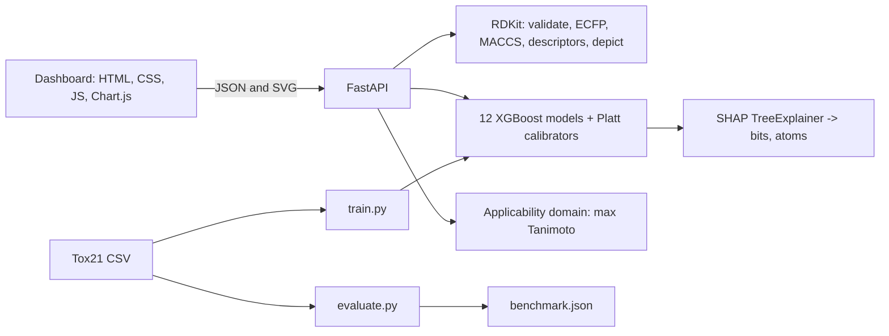

# Tox21 Explainable Toxicity Screening

A research web app that estimates activity for all **12 Tox21 assay endpoints** from a SMILES string. It is built around three questions a screening model has to answer honestly: *how well does it generalize to unseen chemistry, can its probabilities be trusted, and does this molecule even resemble what it was trained on?*

> **Research use only.** Predictions are exploratory model scores for assay activity in the public Tox21 data. They are not validated safety determinations, medical advice, causal evidence, or a substitute for laboratory testing. SHAP values explain model behavior, not biological mechanism.

## What is in the box

| Area | What it does |
|---|---|
| **12 endpoints** | 7 nuclear-receptor assays (AR, AR-LBD, AhR, Aromatase, ER, ER-LBD, PPAR-gamma) and 5 stress-response assays (ARE, ATAD5, HSE, MMP, p53), one XGBoost model each. |
| **Honest evaluation** | `evaluate.py` compares four models under random, Bemis-Murcko scaffold (3 seeds) and strict scaffold splits, with mean ± sd over seeds. |
| **Calibrated probabilities** | Unweighted XGBoost plus Platt scaling fitted on a validation fold. Each score shows its enrichment over the endpoint's base rate. |
| **Applicability domain** | Every prediction carries its max Tanimoto similarity to the training set and an In domain / Borderline / Out of domain flag. |
| **Explainability** | SHAP top features, fingerprint bits mapped to structure fragments, and an atom-level SHAP map drawn on the 2D structure. |
| **Protein and pathway layer** | Each assay is linked to the protein or process it measures (AR, ESR1, CYP19A1, AHR, PPARG, NFE2L2, ATAD5, TP53, HSF1, mitochondria), and the 12 scores roll up into 7 pathway scores, each with a held-out AUC. |
| **Property suite** | MW, LogP, TPSA, H-bond donors/acceptors, Lipinski Rule of Five (a drug-likeness heuristic, not a toxicity rule). |
| **Batch screening** | Upload up to 5,000 SMILES; get a risk-alert summary plus a full CSV (spreadsheet-formula-injection safe). |

## Results (all numbers generated by the code in this repo)

Generated 2026-10-19 from 7,823 parseable Tox21 molecules; each cell is a macro-average over the 12 endpoints, then mean ± sd over 3 seeds. Reproduce with `python -m app.ml.evaluate --seeds 3` (336 model fits, about 25 minutes on one CPU core). The raw per-fit results are in `data/benchmark_runs.jsonl`.

### ROC-AUC
| Model | Random | Scaffold (3 seeds) | Strict scaffold |
|---|---|---|---|
| Logistic regression (ECFP) | 0.796 ± 0.002 | 0.758 ± 0.028 | 0.714 |
| Random forest (ECFP) | 0.817 ± 0.012 | 0.778 ± 0.027 | 0.736 |
| XGBoost (ECFP) | 0.799 ± 0.006 | 0.769 ± 0.026 | 0.714 |
| XGBoost (ECFP+MACCS+descriptors) | 0.851 ± 0.008 | 0.830 ± 0.020 | 0.772 |

### PR-AUC (more informative here: actives are 3% to 16% of each endpoint)
| Model | Random | Scaffold (3 seeds) | Strict scaffold |
|---|---|---|---|
| Logistic regression (ECFP) | 0.432 ± 0.022 | 0.391 ± 0.081 | 0.316 |
| Random forest (ECFP) | 0.455 ± 0.008 | 0.429 ± 0.081 | 0.397 |
| XGBoost (ECFP) | 0.436 ± 0.026 | 0.399 ± 0.080 | 0.320 |
| XGBoost (ECFP+MACCS+descriptors) | 0.516 ± 0.020 | 0.486 ± 0.077 | 0.411 |

F1 and balanced accuracy (threshold chosen on the validation fold only) are in `benchmark.json` (the dashboard does not display the benchmark).

### What the benchmark shows

1. **Random splits overstate generalization.** XGBoost on ECFP scores 0.799 ROC-AUC on a random split, 0.769 on a scaffold split and 0.714 on the strict scaffold split. The original two-endpoint version of this project was evaluated on a random split, so its reported AUCs should be read as optimistic.
2. **Features mattered more than model class.** Logistic regression, random forest and XGBoost on ECFP are within seed noise of one another on the scaffold split. Adding MACCS keys and RDKit 2D descriptors lifts scaffold ROC-AUC to 0.830, a gain well outside that noise. The deployed models use this feature set.
3. **The applicability-domain flag is earned, not decorative.** On scaffold-split test molecules, accuracy falls as similarity to the training set falls (XGBoost on ECFP, mean over endpoints and seeds):

| Max Tanimoto to training set | Test molecules per endpoint | ROC-AUC |
|---|---|---|
| <0.30 | 83 | 0.658 |
| 0.30-0.50 | 297 | 0.744 |
| >=0.50 | 235 | 0.790 |

### Protein and pathway layer

Pathway score = the highest calibrated probability among the pathway's assays (assays inside a pathway are correlated, so combining them as independent evidence would overstate risk). The mapping comes from the Tox21 Data Challenge assay descriptions; it is curated knowledge, not learned from data. To check that the roll-up carries real signal, `python -m app.ml.pathway_eval` scores it on the same held-out scaffold test fold. A molecule gets a pathway label only if it was measured in every member assay (1 if any is active, 0 otherwise); partial measurements are excluded because counting them as positives would inflate the base rate.

| Pathway | Assays | Held-out ROC-AUC | PR-AUC | Active rate | Test molecules (positives) |
|---|---|---|---|---|---|
| Endocrine (sex-hormone) signalling | NR-AR, NR-AR-LBD, NR-Aromatase, NR-ER, NR-ER-LBD | 0.748 | 0.507 | 11.7% | 455 (69) |
| Xenobiotic sensing (AhR) | NR-AhR | 0.851 | 0.565 | 11.2% | 619 (81) |
| Lipid and glucose metabolism (PPAR) | NR-PPAR-gamma | 0.799 | 0.325 | 2.8% | 615 (20) |
| Oxidative stress response (Nrf2/ARE) | SR-ARE | 0.828 | 0.529 | 15.9% | 510 (82) |
| DNA damage and genotoxic stress | SR-ATAD5, SR-p53 | 0.832 | 0.439 | 6.2% | 637 (69) |
| Heat-shock / protein-folding stress | SR-HSE | 0.771 | 0.399 | 5.6% | 595 (42) |
| Mitochondrial function | SR-MMP | 0.915 | 0.704 | 15.2% | 542 (106) |

### Deployed models (scaffold split, seed 0 held-out test fold)

| Endpoint | Active rate | ROC-AUC | PR-AUC | Test actives | Brier raw → calibrated | ECE raw → calibrated |
|---|---|---|---|---|---|---|
| NR-AR | 3.3% | 0.912 | 0.818 | 76 / 714 | 0.0416 → 0.0361 | 0.032 → 0.017 |
| NR-AR-LBD | 2.8% | 0.932 | 0.751 | 61 / 661 | 0.0412 → 0.0364 | 0.036 → 0.025 |
| NR-AhR | 11.2% | 0.851 | 0.565 | 81 / 619 | 0.0824 → 0.0824 | 0.013 → 0.012 |
| NR-Aromatase | 4.8% | 0.850 | 0.401 | 38 / 541 | 0.0539 → 0.0537 | 0.013 → 0.011 |
| NR-ER | 12.3% | 0.735 | 0.494 | 96 / 596 | 0.1096 → 0.1099 | 0.009 → 0.020 |
| NR-ER-LBD | 5.0% | 0.892 | 0.667 | 40 / 674 | 0.0324 → 0.0331 | 0.017 → 0.020 |
| NR-PPAR-gamma | 2.8% | 0.799 | 0.325 | 20 / 615 | 0.0272 → 0.0268 | 0.012 → 0.008 |
| SR-ARE | 15.9% | 0.828 | 0.529 | 82 / 510 | 0.1026 → 0.1031 | 0.033 → 0.036 |
| SR-ATAD5 | 3.4% | 0.819 | 0.295 | 37 / 690 | 0.0452 → 0.0447 | 0.024 → 0.018 |
| SR-HSE | 5.6% | 0.771 | 0.399 | 42 / 595 | 0.0553 → 0.0536 | 0.029 → 0.019 |
| SR-MMP | 15.2% | 0.915 | 0.704 | 106 / 542 | 0.0987 → 0.0955 | 0.057 → 0.045 |
| SR-p53 | 5.5% | 0.840 | 0.378 | 61 / 657 | 0.0722 → 0.0702 | 0.035 → 0.011 |

Test folds contain few actives for some endpoints (see the column above), so single-endpoint numbers are noisy; trust the multi-seed benchmark for comparisons.

## Design decisions and what they cost

- **No `scale_pos_weight`.** The original version re-weighted positives, which pushed scores far above the true active rate. Measured on one split, with identical features (NR-AhR): weighted mean score 0.252 vs true rate 0.131 (ECE 0.123); unweighted 0.129 vs 0.131 (ECE 0.017). Imbalance is handled with PR-AUC and validation-tuned thresholds instead.
- **Platt calibration helps modestly.** After calibration, Brier score improved on 9 of 12 endpoints and ECE on 9 of 12. Because the unweighted model is already close to calibrated, the effect is small and uneven, and a calibrator fitted on only ~600–780 validation molecules per endpoint is itself noisy.
- **Risk bands are display categories** on the calibrated probability: Low < 20%, Medium 20–50%, High ≥ 50%. Base rates are 3–16%, so even "Medium" means several times the background rate; the dashboard shows that enrichment next to each score.
- **Atom map covers only part of the explanation.** Fingerprint-bit SHAP can be assigned to atoms; descriptor and MACCS contributions are whole-molecule. The UI reports what share of each prediction's SHAP weight the map represents (often small for descriptor-driven endpoints). SHAP is computed on the uncalibrated log-odds.
- **RDKit `SimilarityMaps` was tried and dropped:** its contour output was ~1.4 MB per molecule, so the same atom weights are drawn as colored highlights (~20 KB).
- **A graph neural network was not built.** The original plan listed GCN/GraphConv; without evidence it would help, and with the descriptor model already ahead, it was left out rather than reported unrun. It is the natural next experiment.

## Limitations

- The protein and pathway layer is a curated mapping of assay biology. It does not model 3-D binding, protein-protein interaction or exposure, and pathway scores inherit every limitation of the 12 assay models. The pathway-level AUCs use fewer molecules (only those measured in all member assays), so they are noisier for multi-assay pathways.
- Tox21 labels are **qHTS assay activity**, not in vivo toxicity. Actives include assay interference and cytotoxicity artifacts.
- Scaffold splits put every acyclic molecule (one shared empty scaffold, ~23% of the data) into training, so scaffold test folds contain only ring-containing molecules.
- Deployed models are trained on 80% of the data (train fold) so that the reported test metrics describe exactly what is served.
- The applicability-domain cutoffs (0.50 / 0.30) are heuristics supported by the binned analysis above, not guarantees.
- No external validation set; one dataset; the strict-scaffold column is a single run.

## Architecture



```text
tox21-toxicity-app/
├── backend/
│   ├── app/
│   │   ├── api/routes.py          # endpoints
│   │   ├── core/config.py         # 12 targets, risk bands, AD thresholds
│   │   ├── core/biology.py        # assay-to-protein map, pathways, roll-up scores
│   │   ├── core/cheminfo.py       # fingerprints, descriptors, scaffold split, applicability domain
│   │   ├── core/report.py         # batch CSV (injection-safe) and alert summary
│   │   ├── ml/data.py             # dataset + cached features
│   │   ├── ml/evaluate.py         # multi-model, multi-split benchmark (resumable)
│   │   ├── ml/pathway_eval.py     # held-out validation of the pathway layer
│   │   ├── ml/train.py            # production training + calibration
│   │   ├── ml/predictor.py        # inference, SHAP, atom weights
│   │   └── ml/models/             # *.ubj models, *.json metadata, benchmark.json
│   ├── tests/                     # 43 pytest tests
│   ├── requirements.txt / requirements-dev.txt
│   └── Dockerfile
├── frontend/                      # index.html, app.js, styles.css, theme.css, extras.css
├── .github/workflows/ci.yml
├── docker-compose.yml
└── run.sh
```

## Run it

### Docker
```bash
chmod +x run.sh && ./run.sh
```
Dashboard <http://localhost:8080>, API docs <http://localhost:8000/docs>. Trained models are included; `run.sh` trains only if `training_metrics.json` is missing.

### Locally
```bash
cd backend
python -m venv .venv && source .venv/bin/activate      # Windows: .venv\Scripts\activate
pip install -r requirements-dev.txt
python -m app.ml.train                  # ~1 min; downloads Tox21 on first run
python -m app.ml.evaluate --seeds 3     # ~25 min on 1 core; resumable, caches fits in data/
python -m pytest -q
uvicorn app.main:app --reload --port 8000
```
Serve `frontend/` with any static server (for example `python -m http.server 8080 -d ../frontend`) and open it in a browser. Allowed browser origins are set with `CORS_ORIGINS`.

## API

| Method | Path | Purpose |
|---|---|---|
| GET | `/api/health` | Model and applicability-domain status |
| GET | `/api/biology` | Assay-to-protein map and pathway definitions with held-out pathway metrics |
| GET | `/api/targets` | 12 endpoints with base rates and held-out metrics |
| POST | `/api/predict` | Calibrated probabilities, risk bands, enrichment, domain flag, 7 pathway scores, properties |
| POST | `/api/explain` | Top SHAP features per endpoint (fragments for bits, names for descriptors) |
| POST | `/api/explain/map` | SVG with atom-level SHAP shading for one endpoint |
| POST | `/api/predict/batch?format=csv\|json` | CSV screening; `json` adds a risk-alert summary |
| GET | `/api/benchmark` | Benchmark report |
| GET | `/api/calibration` | Brier/ECE and reliability tables |
| POST | `/api/structure`, `/api/properties` | 2D depiction, descriptors and Lipinski |

Input limits: SMILES up to 1,000 characters; batch CSV up to 5 MB and 5,000 rows (descriptor calculation makes large batches take a few seconds per thousand molecules).
# TOXICITY-SCREENING--Tox21-XGBoost

